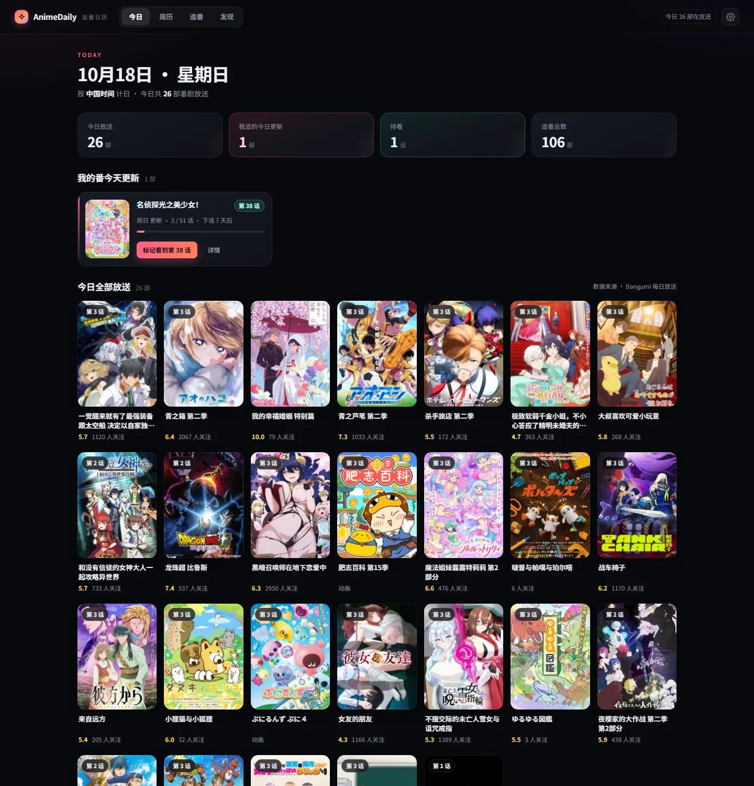
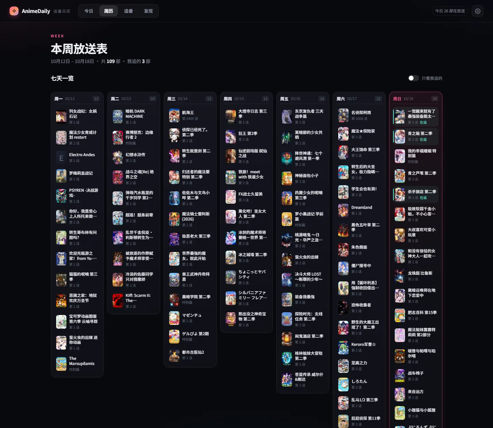
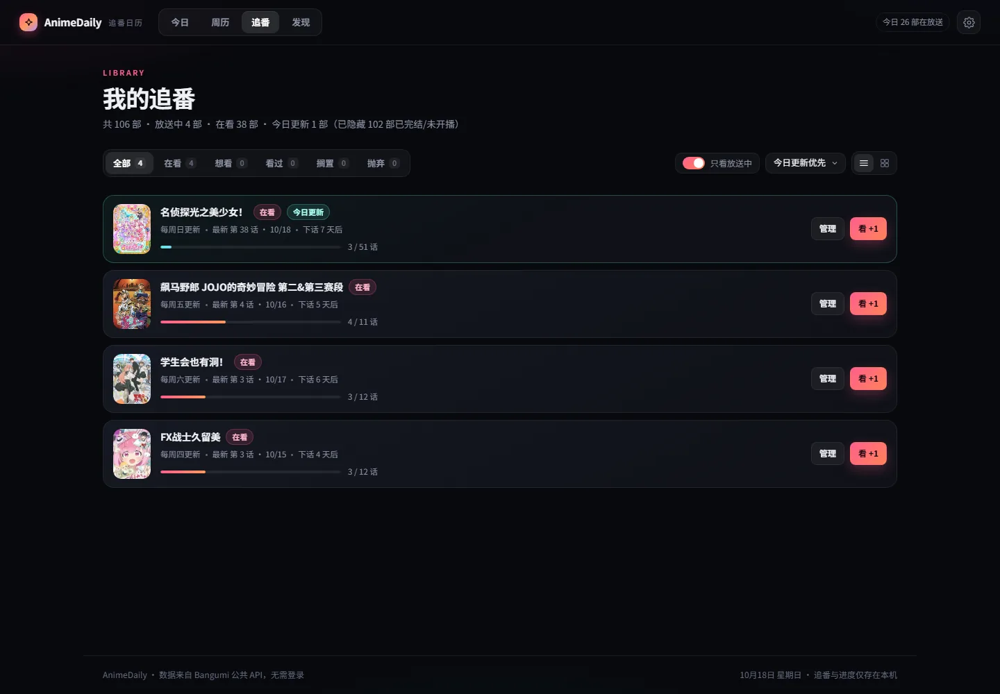
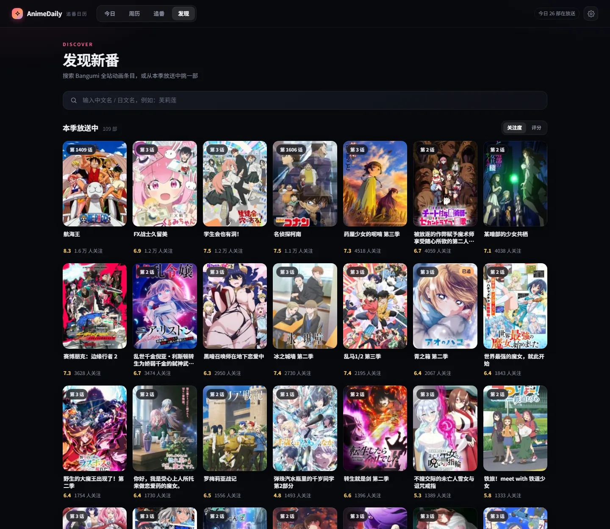
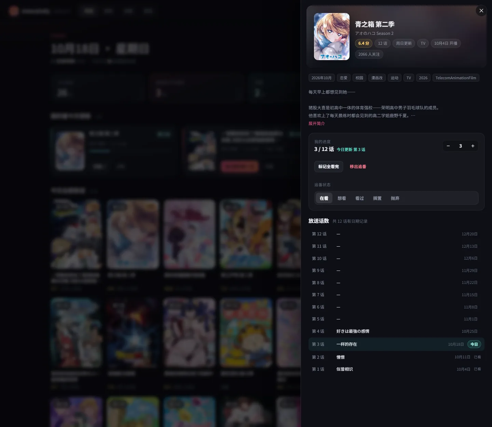

# AnimeDaily · 追番日历

打开就知道：**今天有哪些番剧在放送**、**我追的番今天更新第几话**、**每部追到第几话了**。

数据来自 [Bangumi](https://bgm.tv) 公共 API，不需要登录、不需要注册应用；追番与进度全部存在本机。



---

## 快速开始

1. **确保代理已开启**（Clash / v2rayN 等，默认端口 7890）。`api.bgm.tv` 与封面图床在国区直连会被中断。
2. **双击 `start.cmd`**。首次会自动装依赖并构建前端，之后秒开。
3. 浏览器打开 <http://127.0.0.1:8787>。
4. 进「设置」→ 填你的 Bangumi 用户名 → **导入追番**（拉取你「在看」「想看」的公开收藏与已看集数），之后也可以直接搜索添加。

关闭那个黑色命令行窗口即停止服务。

要求：Node.js 20+（本机已验证 22.14）。构建产物已随项目提供，日常启动不需要联网装依赖。

---

## 手机 / 平板访问

想在手机上刷，同一个 Wi-Fi 下就行：

1. 启动后看命令行窗口里「手机/平板」那一行，形如 `http://192.168.1.3:8787`（带网卡名，一般选 WLAN / 以太网那个）
2. 手机浏览器输入这个地址
3. 如果手机端一直转圈或超时 —— 是 Windows 防火墙拦了。双击项目里的 **`allow-firewall.cmd`**，UAC 弹窗点「是」，再重试

注意：

- **不要用 `127.0.0.1`** —— 在手机上它指向手机自己，必然连接被拒
- 脚本只放行「专用网络 / 域网络」。如果当前 Wi-Fi 被识别成「公用网络」：设置 → 网络和 Internet → Wi-Fi → 属性 → 改成「专用网络」
- 应用没有登录鉴权，同一 Wi-Fi 下的设备都能查看和修改你的追番。家里用没问题；在咖啡厅等公共网络下建议关掉服务，或只用 `HOST=127.0.0.1 node server/index.mjs` 启动（仅本机可访问）

---

## 功能

| 页面 | 内容 |
|---|---|
| **今日** | 顶部四个数字：今日放送 / 我追的今日更新 / 待看 / 追番总数。上半部分是「我的番今天更新」——只统计**正在连载**的作品，显示第几话、放送星期、进度条、一键标记已看；今天空档时会列出「接下来」几部作品的日期与话数。下半部分是今日全部放送（当季番剧，含评分与关注数） |
| **周历** | 周一至周日七列，我追的番高亮并标「在追」；可按「只看我追的」过滤 |
| **追番** | **默认只显示正在放送的作品**（工具栏「只看放送中」，选择会记住），老番不再干扰；按状态筛选（在看/想看/看过/搁置/抛弃）、按今日更新优先/最近更新/名称排序，列表或网格两种视图，进度可点「看 +1」；关掉开关即可看到全部，已完结的条目会标注「已完结 · 非本季连载」 |
| **发现** | 搜 Bangumi 全站动画（中文名/日文名都行），或从「本季放送中」按关注度/评分挑 |
| **详情** | 点任意卡片打开侧栏：简介、标签、评分、全部话数与放送日期、当前进度步进器、追番状态切换、移出追番 |

### 截图

| 周历 | 追番（默认只看放送中） |
|---|---|
|  |  |

| 发现 | 详情侧栏 |
|---|---|
|  |  |

| 手机 · 今日 | 手机 · 追番 |
|---|---|
|  |  |

---

## 「今天更新第几话」是怎么算的

1. 先判断这部作品**是否还在连载**（满足任一即可）：
   - 还有未来话数（`airdate > 今天`）；
   - 出现在 Bangumi 今日放送表里（日历只收录当季）；
   - 上一话在 7 天内播过；
   - 已播话数还没到总话数。
   已完结的作品一律不算「今天更新」，也不会把「每周 X 更新」当成还在放送。
2. 连载中的作品里，取**逐话放送日期**（`episodes.airdate`），找 `airdate == 今天` 的那一话 → 精确命中；
3. 如果该话日期缺失，用**放送星期 + 上一话编号**推算（界面上标「预计」）；
4. 「待看」= 今日更新的话数 > 你已看的集数；
5. 时区默认按**中国时间（北京时间）**计日——北京 23:11 就还是「今天」，不会提前跳到日本时间的次日；在设置里可切「日本放送日」对照日本原播出日。

Bangumi 没有「几点播出」的字段，所以本应用只显示到**日期**，不编造时刻。

**今天没有更新时**：会显示「还在连载 N 部」以及接下来几部作品的具体日期与话数，而不是一片空白。

**想看历史番剧的放送日**：设置里有「显示历史番剧」开关（默认关闭）。打开后，已完结但放送星期与今天相同的作品也会出现在「今日更新」里，并标「预计」。

---

## 数据与缓存

```
data/store.json     你的追番列表、进度、设置（纯文本，可直接备份/迁移）
data/covers/        封面图缓存（约 400px 规格）
data/cache/         接口缓存：放送表 1h、逐话日期 12h、条目 7d
```

设置页可以查看占用、强制刷新话数、一键清空缓存。换电脑只要拷走 `data/store.json`。

---

## 常见问题

**页面说「代理不可用」/ 放送表拉不出来**
确认 Clash 在运行，且「设置 → 代理地址」与它一致（默认 `http://127.0.0.1:7890`）。点「测试连通」会分别显示代理与直连的结果。代理不可用时，已缓存的数据仍能浏览。

**封面是大片空白**
首屏封面是后台预热 + 逐张下载的，冷启动等几秒会自己补齐；前端还会对失败图片自动重试两次。

**某部番的放送日不对**
Bangumi 的放送日是社区维护的，可能有偏差。可以在详情里退出重进以拉取最新数据，或在设置里「刷新追番话数」强制重取。

**导入的追番没有进度**
导入会带上 Bangumi 的 `ep_status`；如果你在 Bangumi 上没标记进度，这里自然从 0 开始。导入是**只读**的，不会写回 Bangumi，也不会覆盖你本地已有的进度。

**导入后发现「今日更新」里没有我的老番**
这是有意的：老番早已完结，不该算作「今天更新」。如果你确实想看历史番的放送日，去设置打开「显示历史番剧」开关。追番列表里它们仍会显示，并标注「已完结 · 非本季连载」。

**追番页看不到我追的老番了**
追番页默认开启「只看放送中」，只列正在连载的作品（工具栏上那个开关）。关掉它就能看到全部 100 多部，这个选择会被记住。

**想改成每天开机自启**
把 `start.cmd` 的快捷方式放进 `shell:startup` 即可。

---

## 开发

```bash
node server/index.mjs          # 后端（端口 8787）
npm --prefix web run dev       # 前端热更新（端口 5173，已代理 /api）
npm --prefix web run build     # 构建到 web/dist
```

> 改批处理时注意：`start.cmd` / `allow-firewall.cmd` 必须保持**纯 ASCII + CRLF**。
> cmd 会按控制台代码页（中文系统是 GBK）解析 `.cmd` 文件，UTF-8 中文会变乱码，甚至把 `if (...)` 的括号拆坏成假命令。
> 需要中文提示请写进 `scripts/msg.mjs`，由 Node 打印（Node 在 Windows 控制台走宽字符接口，显示正常）。

目录：

```
server/index.mjs        HTTP 服务与全部 API 路由
server/lib/bgm.mjs      Bangumi 客户端（字段归一化 + 缓存）
server/lib/util.mjs     代理隧道（CONNECT + keep-alive）、限速、重试
server/lib/schedule.mjs 日期/星期/话数推算
server/lib/store.mjs    追番与设置持久化（原子写）
server/lib/image.mjs    封面中转与预热
web/src/pages/          今日 / 周历 / 追番 / 发现 / 设置
web/src/components/     卡片、封面、详情抽屉、通用 UI
```

API 一览：`/api/today` `/api/week` `/api/follows` `/api/subject/:id` `/api/search?q=` `/api/import/bangumi` `/api/settings` `/api/sync` `/api/network/probe` `/api/img?u=`。

---

## 已知限制

- 只读导入 Bangumi：不会把你的进度写回 Bangumi（要写回需要 OAuth 应用，可后续加）。
- 隔周放送、分割放送的番，在逐话日期缺失时用每周推算会偏差，此时界面标「预计」。
- 首次冷启动（清空缓存后）需要几十秒把封面和逐话日期补齐；之后是本机缓存，瞬间打开。
